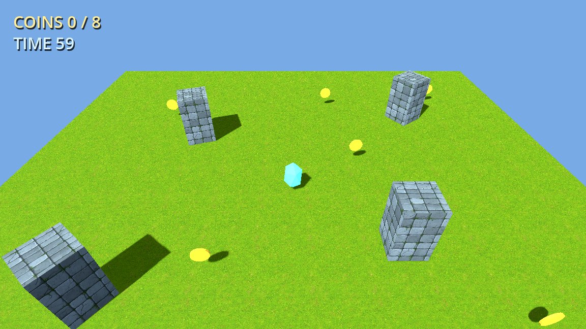
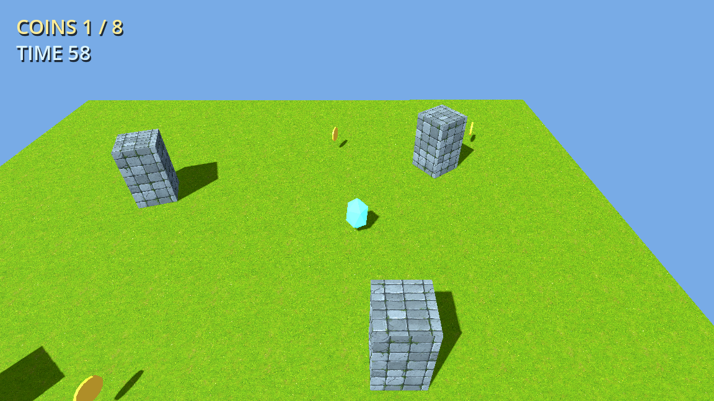

# Crystal Rush · 水晶疾跑

> 一个用来打通 **Blender MCP → Agnes MCP → Godot MCP** 全链路的 3D 小游戏 Demo。
> 60 秒内收集场上全部 8 枚金币。模型由 Blender 程序化生成，贴图由 AI 生成，场景与逻辑在 Godot 里落地。


---

## 预览

| 开局 | 收集 1 枚后 |
|---|---|
|  |  |

---

## 玩法

在 26 × 26 的浮空草地上，**60 秒内收集全部 8 枚金币**。

| 操作 | 键位 |
|---|---|
| 移动 | `W` `A` `S` `D` 或方向键 |
| 跳跃 | `空格` |
| 重开 | `R` |

- 集齐 8 枚 → 胜利，显示 `ALL COINS COLLECTED!`
- 倒计时归零 → 失败，显示 `TIME UP!`
- 掉出场地边缘 → 自动复位到出生点

---

## 快速开始

**方式一：编辑器**

用 Godot **4.7.2**（或 4.6+）打开本目录，按 `F5`。

**方式二：命令行**

```bash
godot --path /path/to/game1
```

首次打开时 Godot 会自动导入 `assets/` 下的模型与贴图，生成 `.godot/` 缓存目录（已在 `.gitignore` 中忽略）。

---

## 资产产线

这个项目的重点不在玩法，而在**三个 MCP 串起来的资产流水线**：

```
Blender MCP  ──►  GLB 模型（水晶玩家 / 金币）
Agnes MCP    ──►  1024×1024 贴图（草地 / 石砖）
                        │
                        ▼
Godot MCP    ──►  建场景 · 写 GDScript · 导入资源 · 跑起来验收
```

| 资产 | 生产者 | 规格 |
|---|---|---|
| `assets/models/player_crystal.glb` | Blender 5.2.3（程序化 ico 球） | 0.79 × 1.43 × 0.75，原点居中 |
| `assets/models/coin.glb` | Blender 5.2.3（16 边圆柱） | 直径 0.64，原点居中 |
| `assets/textures/ground_grass.png` | `agnes-image-2.5-flash` | 1024×1024，可平铺 |
| `assets/textures/stone_brick.png` | `agnes-image-2.5-flash` | 1024×1024，用于四根石柱 |

---

## 目录结构

```
game1/
├── project.godot              # 应用名 Crystal Rush，主场景 scenes/main.tscn
├── scenes/
│   └── main.tscn              # 根节点 Main，挂 scripts/game.gd
├── scripts/
│   ├── game.gd                # 场地 / 光照 / 金币生成 / 跟随相机 / 回合与 HUD
│   ├── player.gd              # 移动、跳跃、坠落复位
│   └── coin.gd                # 自转浮动、拾取判定
├── assets/
│   ├── models/                # Blender 导出的 GLB（含 .import）
│   └── textures/              # AI 生成的贴图（含 .import）
├── addons/godot_mcp/          # 第三方插件：Godot MCP（用于 AI 协作编辑，跑游戏本身不需要）
└── docs/                      # 截图与说明
```

---

## 实现要点

**全部场景内容由 `game.gd` 在运行时构建**，`main.tscn` 只有一个挂了脚本的根节点。这样做的原因：

1. 贴图需要在引擎侧包装成 `StandardMaterial3D` 才能控制 UV 缩放；
2. GLB 模型要在运行时 `load()` + `instantiate()`，避免手写 `.tscn` 的 `ExtResource` 引用；
3. 场地、金币、相机参数集中在一个文件里，调起来直观。

核心逻辑都在 `scripts/game.gd`：

- `_build_arena()` — 26×26 草地平面 + 碰撞体 + 四根石柱
- `_build_coins()` — 按固定坐标生成 8 个 `Area3D` 金币，连 `body_entered`
- `_process()` — 倒计时、相机跟随、`R` 重开
- `_game_over()` — 冻结玩家物理、显示结算

---

## 踩坑记录

给想复刻这条流水线的人，这些坑我替你踩过了：

**1. Blender 中文界面下节点名会变**

`Principled BSDF` 在中文界面里叫「原理化 BSDF」。按名字查找会拿到 `None`，必须按类型查：

```python
for n in mat.node_tree.nodes:
    if n.type == 'BSDF_PRINCIPLED':
        return n
```

**2. GLB 导出前必须烘入变换**

不 `transform_apply(location=True, rotation=True, scale=True)`，对象原点会带偏移，进 Godot 后位置全歪。

**3. `:=` 类型推断在 `instantiate()` 上会挂**

```gdscript
var packed := load("res://assets/models/coin.glb")  # 静态类型是 Resource
var model := packed.instantiate()                    # ❌ Cannot infer type
```

要写显式类型：

```gdscript
var packed: PackedScene = load("res://assets/models/coin.glb")
var model: Node3D = packed.instantiate()             # ✅
```

**4. GL Compatibility 渲染器下纯金属材质会发黑**

Blender 里设 `metallic = 1.0` 的金币，在没有环境反射的 GL Compatibility 下渲染成纯黑。正解是不依赖 GLB 自带材质，在 GDScript 里遍历 `MeshInstance3D` 用 `material_override` 接管：

```gdscript
func _apply_material(node: Node, mat: Material) -> void:
    if node is MeshInstance3D:
        node.material_override = mat
    for child in node.get_children():
        _apply_material(child, mat)
```

**5. 资源没自动导入时手动触发**

```bash
godot --headless --path . --import
```

---

## 已知限制

- 相机是固定俯角的平滑跟随，没有遮挡规避。
- 金币无音效、无粒子反馈。
- 场地没有边界墙，靠坠落判定复位。
- `addons/godot_mcp` 是第三方插件（[Godot-mcp](https://github.com/anengyuki/Godot-mcp)），仅用于 AI 辅助编辑，**玩游戏本身不需要它**。

---

## 许可

游戏代码与资产为本项目原创，可自由使用。
`addons/godot_mcp/` 版权归其原作者所有（MIT）。
